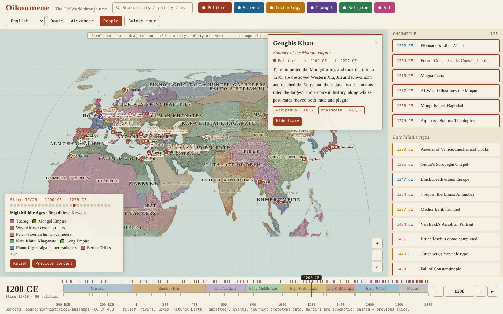

<p align="center"></p>

<h1 align="center">Oikoumene</h1>
<p align="center"><em>The inhabited world, 500 BCE → 2000 CE, on one map you can scrub through time.</em></p>
<p align="center">
<a href="https://oikoumene.pages.dev">Live</a> ·
<a href="#try-these">Try these</a> ·
<a href="#data">Data</a> ·
<a href="CONTRIBUTING.md">Contribute</a> ·
<a href="docs/README.zh.md">中文说明</a>
</p>

---

**Oikoumene** (οἰκουμένη, *oy-koo-MEH-nee*) was the Greek word for "the inhabited world": everything the ancients knew of, from the Pillars of Hercules to the land of the Seres. This atlas draws that world — Atlantic to Japan, Equator to Arctic — as a single continuous map with a timeline underneath, so you can watch empires rise, cities change their names, and people move across it.

It is a static site. One HTML file, a folder of JSON, [d3-geo](https://github.com/d3/d3-geo) for the projection. No backend, no accounts, no tracking.

## What is on the map

| Layer | What you get |
|---|---|
| **Borders** | 29 slices between 500 BCE and 2000 CE. The previous slice is ghosted as a dashed line so gains and losses are visible at a glance. |
| **Relief** | Shaded terrain, rivers, lakes, named ranges, deserts and peaks under everything, so an empire sits on the mountains and deserts that shaped it. |
| **Cities** | 128 cities with every name they have carried, in the script of whoever ruled them (Byzantion → Constantinople → Qusṭanṭīniyya → İstanbul), their capital periods, and for the major ones a tagline and a short history. |
| **People** | 62 figures shown where they lived during the current slice. Each has a biography and a *Trace life* button that draws their movements: Alexander to the Indus, Xuanzang to Nalanda, Ibn Battuta to Hangzhou. |
| **Events** | 138 events in six colour-coded categories: politics, science, technology, thought, religion, art. They appear on the map, on the timeline, and in a chronicle column grouped by era. |
| **Tour** | One button flies through every period and lands on its defining event. |
| **Languages** | English, 中文, Français, Deutsch, Español. Every card links to Wikipedia. |

## Try these

| | |
|---|---|
| [`?year=-323`](https://oikoumene.pages.dev/?year=-323) | The world the year Alexander died |
| [`?year=1200`](https://oikoumene.pages.dev/?year=1200) | Just before the Mongols |
| [`?year=1453&lang=en`](https://oikoumene.pages.dev/?year=1453&lang=en) | Constantinople falls |
| [`?journey=alexander`](https://oikoumene.pages.dev/?journey=alexander) | Alexander's campaigns drawn on the map |
| [`?tour=1`](https://oikoumene.pages.dev/?tour=1) | Sit back and watch |

Search the box at the top for any city, person, polity or event, in any of its names. Click a person, then *Trace life*. Toggle event categories with the coloured chips.

## Run it yourself

```bash
git clone https://github.com/wangyuexiang/oikoumene.git
cd oikoumene/public && python3 -m http.server 8000
```

Deploy by pointing any static host at `public/`. On Cloudflare Pages or Vercel: no build command, output directory `public`.

## Data

Everything is plain JSON under `public/data/`, written to be edited by hand:

| File | Contents |
|---|---|
| `emea_<year>.json` | Border polygons for one slice, with `en` and `zh` names |
| `cities.json` | Name genealogy, capital periods, tagline, history, Wikipedia titles |
| `people.json` | Lifespan, home, category, biography, journey stops, Wikipedia titles |
| `events.json` | Year, category, place, text, Wikipedia titles |
| `physical.json` · `relief.webp` | Natural Earth land, water, ranges, peaks; shaded relief |

`scripts/` rebuilds borders and the physical layer from their upstream sources. [CONTRIBUTING.md](CONTRIBUTING.md) shows how to add a city, a person, an event, or correct a border, with copy-paste examples.

## Themes

A theme is a story you step into: the map narrows to its years and places, and you walk it stop by stop. One exists today (Alexander); 30 more are proposed in [docs/THEMES.md](docs/THEMES.md) — wars and their routes, the Grand Tour, the Silk Road, the Black Death, how Greek learning travelled into Arabic and back. **Vote with 👍 on the issues tagged `theme`** and we build them in that order.

## Sister project

Oikoumene is modelled on [江山时序 jiangshan-map](https://github.com/DeanChensj/jiangshan-map) by Dean Chen, which does the same for China with hand-digitised borders and reign-era chronology. The two share an interaction model and a `?year=` link convention. The intention is that place links hop between them, so a journey from Chang'an to Baghdad can be followed end to end.

## Known limits

- Borders come from [historical-basemaps](https://github.com/aourednik/historical-basemaps), a continental-scale dataset with known errors. They are schematic. The plan is to replace them period by period with hand-digitised borders referenced to Euratlas and the Barrington Atlas.
- Biographies and city histories are short orientations written for this atlas, not scholarship. Corrections are welcome as issues or pull requests.
- Polity names and event text exist in English and Chinese; the other UI languages fall back to English for those fields.

## Built with Claude

This atlas was designed and built in conversation with [Claude](https://claude.ai) (Anthropic), over two days in November 2026: the data pipeline, the page, the biographies and city histories, and this README. The direction, the editorial choices and the name are Yuexiang Wang's; the keystrokes are mostly Claude's. Commits are signed accordingly. If something is wrong, it is still our fault, and an issue is the right place to say so.

## Credits and licence

- Borders: [aourednik/historical-basemaps](https://github.com/aourednik/historical-basemaps), CC BY 4.0
- Relief, rivers, lakes, land: [Natural Earth](https://www.naturalearthdata.com/) and matplotlib `basemap-data`, public domain
- Projection and geometry: [d3-geo](https://github.com/d3/d3-geo), ISC · Equal Earth projection by Šavrič, Patterson and Jenny
- Fonts: Cormorant Garamond, Noto Serif SC, IBM Plex Mono (Google Fonts)
- Interaction model after jiangshan-map (GPL-3.0; no code reused)

Code and curated data in this repository: [MIT](LICENSE).
